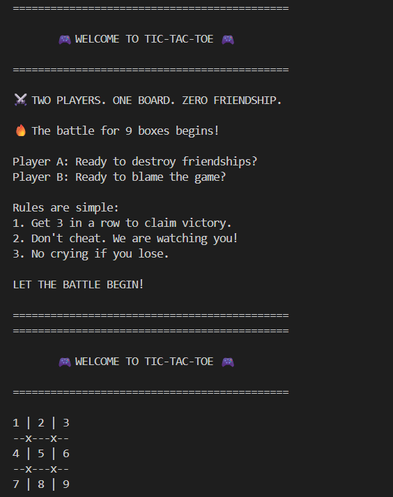
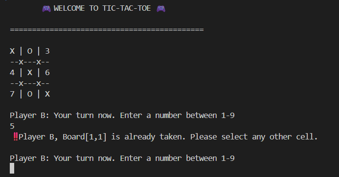
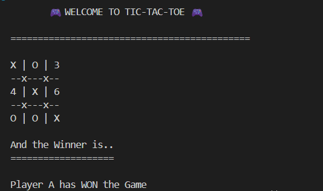

# 🎮 Tic Tac Toe – C#

A console-based Tic Tac Toe game developed using **C#** and **.NET**.

## 📌 About the Project

This project is being developed as part of my C# learning journey. The objective is to understand and apply fundamental programming concepts by building a classic Tic Tac Toe game.

The application is designed as a two-player, console-based game where players take turns making moves on a 3×3 game board.

As development progresses, the code is being organized into separate classes and methods to improve readability, maintainability, and code reusability.

## 🛠️ Technologies Used

- C#
- .NET
- Visual Studio Code
- Git & GitHub

## 📂 Project Structure

The application is being organized into separate classes, with each class responsible for handling a specific part of the game.

| File / Class | Responsibility |
|---|---|
| `Program.cs` | Main entry point of the application. Handles the overall game flow and coordinates player interactions. |
| `TicTacToeBoard.cs` | Contains the `TicTacToeBoard` class, responsible for displaying the game board. |
| `PlayerAWinnerCheck.cs` | Contains the `PlayerAWinnerCheck` class, responsible for checking Player A's winning combinations across rows, columns, and diagonals. |
| `PlayerBWinnerCheck.cs` | Contains the `PlayerBWinnerCheck` class, responsible for checking Player B's winning combinations across rows, columns, and diagonals. |

## 📂 Project Structure

```text
Tic-Tac-Toe-CSharp/
│
├── Program.cs
├── TicTacToeBoard.cs
├── PlayerAWinnerCheck.cs
├── PlayerBWinnerCheck.cs
├── README.md
```
## 🎯 Game Features

- Two-player console-based gameplay.
- Interactive 3×3 game board.
- Players take turns placing X and O.
- Input validation to prevent invalid selections.
- Prevents players from selecting an already occupied cell.
- Converts player selections into the corresponding board positions.
- Checks winning combinations across: Rows, Columns, Diagonals
- Declares the winner or a draw.
- Simple and humorous game introduction.

## 📸 Application Preview

### 1. Game Launch Screen

<!-- Add game launch screenshot here -->



### 2. Preventing occupied-cell selection

<!-- Add gameplay screenshot here -->



### 3. Game Result

<!-- Add winning / draw result screenshot here -->



## 🚀 Getting Started

### Prerequisites

- .NET SDK installed on your machine.
- Visual Studio Code.
- Git (optional, for cloning the repository).

### Installation & Execution

1. Clone this repository:

   ```bash
   git clone https://github.com/baldeep1993/Tic-Tac-Toe-CSharp.git
   ```

2. Navigate to the project directory:

   ```bash
   cd Tic-Tac-Toe-CSharp
   ```

3. Open the project in Visual Studio Code.

4. Run the application:

   ```bash
   dotnet run
   ```

## 📚 Learning Objectives

Through this project, I aim to strengthen my understanding of:

- C# fundamentals and syntax.
- Variables, data types, and methods.
- Classes and static methods.
- Multidimensional arrays.
- Loops and conditional statements.
- Boolean logic and return values.
- Player turn management.
- Implementing game-winning conditions.
- Organizing code across multiple files.
- Using Git and GitHub for version control.

## 🚧 Project Status

**Note:** This project is a personal learning exercise. The implementation and project structure may evolve as I explore additional C# concepts and best practices.

⭐ If you find this project interesting, feel free to explore the code!